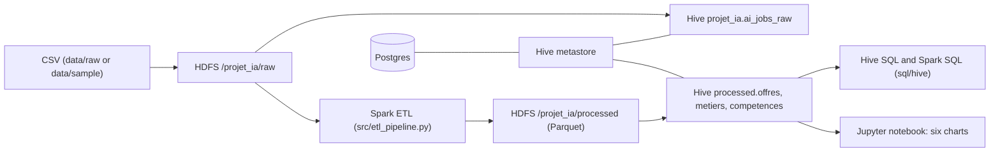

# bigdata-ai-jobs-market

A Big Data chain (HDFS, Hive, Spark, Jupyter) over a public AI job-market dataset: ingestion, cleaning, a three-table model, Hive SQL and Spark SQL analyses, a dashboard, and a LaTeX report. ESIEA coursework, rebuilt to run from one command.

[](https://github.com/PaulPerigault/bigdata-ai-jobs-market/actions/workflows/ci.yml)
[](https://scorecard.dev/viewer/?uri=github.com/PaulPerigault/bigdata-ai-jobs-market)
[](pyproject.toml)
[](LICENSE)

## Overview

The assignment: build a complete Big Data pipeline on 1500 AI job postings (25 columns) and answer business questions with Hive SQL, Spark SQL and a dashboard of at least six charts.

Engineering choices:

- **HDFS and Hive stay in the chain.** Spark reads the raw CSV from HDFS, writes Parquet to HDFS, and the processed tables are Hive external tables. The notebook never reads the local CSV ([project notes](docs/project-notes.md)).
- **Stable keys.** `metier_id` is a truncated `sha2(job_title, 256)`, not an auto-increment: the same input gives the same key on every run.
- **Every cleaning rule is counted.** Nulls before and after, duplicates on `job_id`, rows dropped for a salary at or below 0.
- **Reproducible without the real data.** The real dataset is not redistributed ([ADR 0002](docs/adr/0002-synthetic-sample-instead-of-the-dataset.md)); a seeded synthetic sample with the same 25 columns drives the smoke test and `task demo`.
- **Pinned everywhere.** Docker images by tag and digest, Python by `uv.lock` (hashes), dev tools by `tools/go.sum`, workflow actions by commit SHA. The few Go programs of `dev/` are tooling only ([ADR 0001](docs/adr/0001-python-product-go-tooling.md)).

## Context

- **Period:** 2026-09 to 2026-09. First commit 2026-09-11, last commit 2026-09-28, 49 commits on four branches; the default branch holds 36 of them and stops on 2026-09-18. The original deadline was 2026-09-21. This repository was rebuilt and published as a single clean commit on 2026-11-13, so its Git dates are those of the clean-up, not of the work.
- **Origin:** ESIEA coursework, module *Fundamentals of Big Data*, team project (five students). Personal contribution of Paul Perigault: all 36 commits of the default branch were made from his accounts (Docker Compose stack, ETL pipeline, Hive and Spark queries, dashboard, CI and repository tooling). The other team members' work is not claimed here.
- **Why:** the assignment asks for a complete Big Data chain on the AI job market 2025-2026 (stated in the report, chapter 1). Beyond the grade, the repository was kept as a worked example of a reproducible Hadoop, Hive and Spark setup.
- **What was redone, and when (2026-11-13):** tests and a smoke test on a synthetic sample, locked Python environment, pinned Compose images, notebook outputs removed, CI, hooks and documentation, and the removal of third-party names and machine-specific files. See the [audit](docs/audit-bigdata-ai-jobs-market.md) and the [decision log](docs/decisions-log.md).

## Architecture



The stack is six containers (namenode, datanode, Postgres, Hive metastore, HiveServer2, Jupyter) described in `compose.yaml`.

## Quick Start

Requirements: Go (for the pinned dev tools), Python 3.11 with [uv](https://docs.astral.sh/uv/), Docker for the stack. No Java to install for the tests: `task jdk` uses a valid JDK 11 or 17 from `JAVA_HOME`, else downloads the pinned Temurin 17 into `.tools/jdk` and checks its SHA-256 ([ADR 0005](docs/adr/0005-pinned-jdk-resolved-by-the-project.md)).

```
pip install uv==0.13.8
task setup
task verify
```

`task` is the entry point; without it installed, run `go tool -modfile=tools/go.mod task <target>`. The whole chain on the synthetic sample (needs Docker, about 8 GB of RAM, first image pull is slow):

```
task demo
```

With the real dataset, see [data/README.md](data/README.md), then `task ingest`, `task hive:raw`, `task etl`.

## Usage

Output captured on 2026-11-13 (Windows 11, Temurin 17.0.21, CPython 3.11, uv 0.13.8):

```
$ task data:check
data/sample/ai_jobs_sample.csv: matches the generator (60 rows, seed 2026)
$ uv run pytest
tests/unit/test_cleaning.py ..
tests/unit/test_row_counts.py .
tests/unit/test_sample_data.py ....
tests/unit/test_smoke_sample.py .
tests/unit/test_tables.py ....
12 passed
```

Main targets: `task verify`, `task test`, `task jdk`, `task lint`, `task fmt`, `task data:gen`, `task data:check`, `task data:raw:check`, `task up`, `task down`, `task ingest`, `task ingest:sample`, `task hive:raw`, `task etl`, `task hive-shell`, `task jupyter`, `task demo`, `task report`, `task docker:scan`, `task compose:check`.

## Development

- `task verify` is what CI runs: format, lint, tests, docs check, sample check, skills check, gitleaks on the tree and the history. It is also the pre-push hook.
- `task test` (so `task verify`) resolves its JDK with `task jdk` and sets `REQUIRE_SPARK=1`: the 12 Spark tests run, they are never skipped silently. Running `uv run pytest` by hand without a JDK 11 or 17 skips them, loudly.
- Commits follow Conventional Commits, enforced by the `commit-msg` hook. Rules for people and agents are in [AGENTS.md](AGENTS.md).
- Notebook outputs are never committed (`task nb:check`).

## Project Structure

```
compose.yaml, compose.override.yaml   the stack and its local overrides
src/etl/                              schema, cleaning, tables, Hive output
src/etl_pipeline.py                   Spark job run by task etl
src/Analyse_Marche_Emploi_IA_PySpark.ipynb   exploration and dashboard (no outputs)
sql/hive/                             RAW DDL, analyses, KPIs
tests/unit/                           pytest: cleaning, tables, row counts, sample, smoke test
data/                                 synthetic sample, its generator, real-data checksum
report/                               LaTeX report (French), built by task report
dev/                                  Go tooling: checkdocs, commitlint, skillscheck, jdk
tools/                                separate Go module: pinned dev tools
docs/                                 ADR, decision log, journal, audit, project notes
```

## Related

- [paulperigault.fr](https://paulperigault.fr): portfolio and project page.
- [design-system](https://github.com/PaulPerigault/design-system): shared tokens (this repository has no web front end).

## Roadmap

Planned work is in the [milestones](https://github.com/PaulPerigault/bigdata-ai-jobs-market/milestones): v0.2.0 reproducible local run, v0.3.0 analysis quality, v0.4.0 modern stack.

## Limits

What runs, and what does not:

- **Run on 2026-11-13:** `task verify` (format, lint, 12 tests with Spark 3.5.0 on a JDK 17, docs check, sample check, gitleaks) and `docker compose config`.
- **Not run in this rebuild:** the Docker stack (`task up`, `task demo`, `task etl`, `task docker:scan`, `task report`) because no Docker daemon was available. The stack ran on the original authors' machines in September 2026 (project notes); it has not been re-run since the rebuild.
- **CI has never run on GitHub runners** at the time of writing.
- The **real dataset is not in the repository** and its licence is not stated on its public page. The figures in the report come from it; the repository can only reproduce them if you download it and `task data:raw:check` passes.
- The **images are old and unpatched**: Hadoop 2.7.4, Hive 2.3.2, amd64 only (emulated on Apple Silicon, slow). They carry known vulnerabilities; this is a local teaching stack, not a service. `task docker:scan` scans the repository files, not these images.
- **PySpark 3.5 (pinned 3.5.8) needs Java 11 or 17 and, on Windows, CPython 3.11** ([ADR 0003](docs/adr/0003-java-and-python-pins-for-spark-tests.md)).
- Median salary from `PERCENTILE_APPROX` differs between Hive and Spark SQL; the report uses the Hive value.
- The report and the SQL comments are in French.

## Author

Paul Perigault, Cloud & DevOps Engineer | [paulperigault.fr](https://paulperigault.fr)
