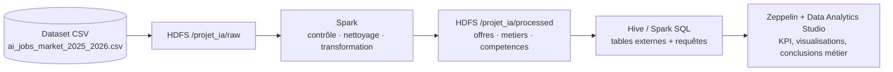
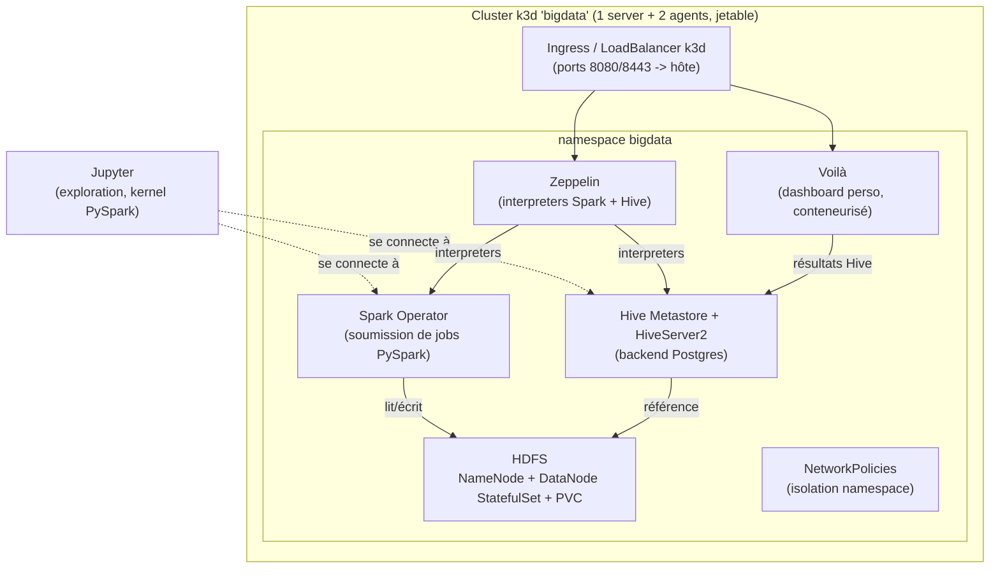

# Architecture

Deux couches à distinguer : le pipeline data imposé par le sujet
(`docs/sujet-synthese.md`), et l'infrastructure k3d qui l'héberge
(`CLAUDE.md`, section Stack technique). Ce document sert de source pour
`report/sections/03-architecture.tex`.

## Pipeline data (imposé par le sujet)



## Infrastructure k3d (héberge le pipeline)



## Rôle de chaque composant

| Composant | Rôle |
|---|---|
| HDFS | Stockage distribué, zones `raw` / `processed` / `output` |
| Hive Metastore + HiveServer2 | Catalogue de tables externes sur HDFS, exécution SQL |
| Spark Operator | Soumission et cycle de vie des jobs PySpark sur k8s |
| Jupyter | Exploration interactive (kernel PySpark connecté au cluster) |
| Zeppelin (+ DAS si le temps le permet) | Dashboard académique obligatoire : requêtes + visualisations |
| Voilà | Interface personnelle (portfolio), résultats Hive, derrière l'ingress |
| NetworkPolicies | Isolation réseau du namespace `bigdata` (durcissement J9) |

## Organisation HDFS (raw / processed / output)

```
/projet_ia/
├── raw/                          # CSV brut déposé tel quel
├── processed/
│   ├── offres/                   # 1 ligne par offre
│   ├── metiers/                  # référentiel métiers, metier_id stable
│   └── competences/               # 1 ligne par offre x compétence
└── output/                       # résultats agrégés / exports pour Zeppelin-DAS
```

Voir `docs/dataset-schema.md` pour le détail des colonnes source, et
`docs/sujet-synthese.md` pour le modèle logique complet (clés, jointures).
